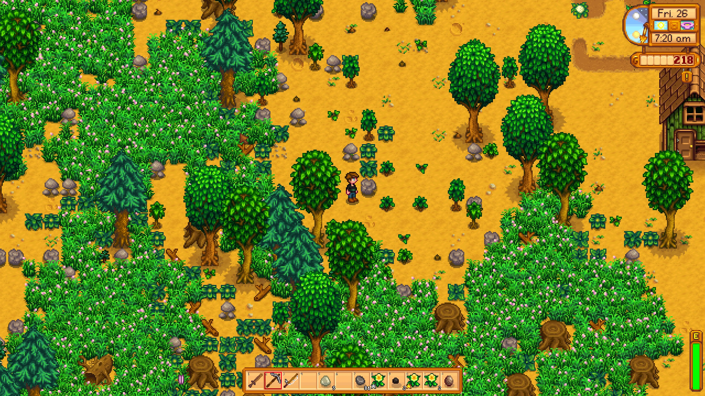

# Introduction

**stardew-tree-sim** is a simulation and mathematical analysis of a simplified
model of tree population dynamics, based on how trees grow and spread in the
video game *Stardew Valley*.

On a Stardew Valley farm, trees, grass and other vegetation spread on their own
to fill any available space. Thinking like a biologist, we might ask:

- How quickly do trees fill an area?
- Can a tree population go extinct?
- When several species compete, will one of them eventually die out?

None of this is needed to play the game. But these are exactly the kinds of
questions mathematical biologists ask of real populations, and the game's rules
are simple enough to study precisely. Either way, the challenge is the same:
working out the *emergent* properties of the population from the simple rules
that govern each individual tree.

## How this book is organized

- **[Trees in Stardew Valley](the-game.md)** looks how trees spread and propagate 
  in the game itself. The game is inspiration for the stochastic cellular automata
  but there are deviations.
- **[Cellular Automata](math/cellular-automata.md)** and
  **[Neighborhoods and Boundaries](math/neighborhoods.md)** turn those
  observations into a mathematical model.
- **[Markov Chain Analysis](math/markov-chains.md)** analyzes the model's
  long-run behavior.
- **[Neighbor Counting by Convolution](implementation.md)** explains how the
  simulation is computed efficiently.

For the code itself, see the
[API documentation](https://docs.rs/stardew-tree-sim).
