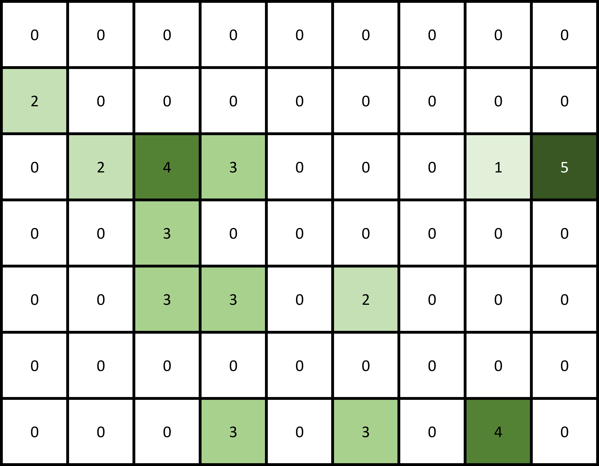
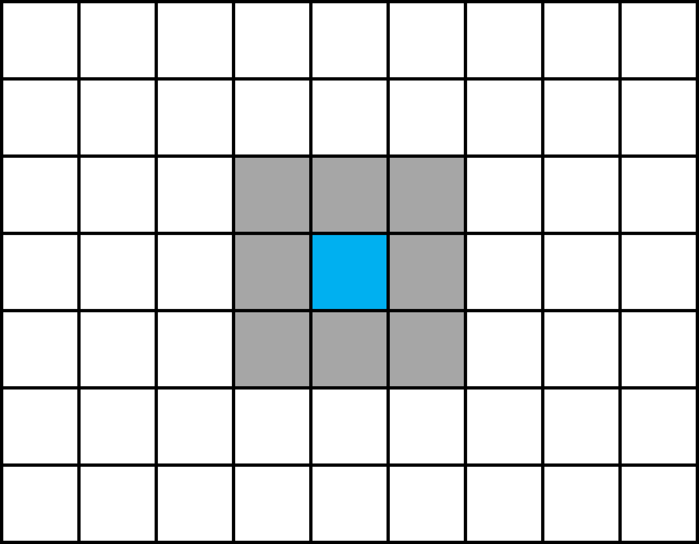

# Cellular Automata

## Definition

A [cellular automaton](https://en.wikipedia.org/wiki/Cellular_automaton) is a
grid of cells, often called a *lattice* and represented by the integer points
\\(\mathbb{Z}^n\\). Each cell holds a value from a finite set of **states**
\\(S\\), which we can label with integers.

A choice of state for every cell is a **configuration** of the grid (sometimes
also just called a state):

\\[
c : \mathbb{Z}^n \to S .
\\]

Time is discrete too. At each step, a **transition rule** (or *update rule*)
\\(F\\) maps the current configuration to the next one:

\\[
c_{t+1} = F(c_t).
\\]

The transition rule plays the same role that an equation of motion plays for a
continuous system. Cellular automata are a kind of dynamical system where both 
time and states are discrete. Moreover, the states have a grid spatial structure.

## Stardew Valley trees as a cellular automaton

In *Stardew Valley*, trees occupy positions on a lattice, and each cell's state is
either empty ground or one of the tree growth stages. Other tree species,
grass and so on are just more states.

## Local rules

In principle, a transition rule can be any function from configurations to
configurations. The interesting ones are usually **local**: the new state of a
cell depends only on its own current state and the states of nearby cells.

Formally, a **neighborhood** is a finite set of offsets
\\(N = \\{v_1, \dots, v_k\\} \subset \mathbb{Z}^n\\), and a local rule is a
function \\(f : S^k \to S\\). The global rule applies \\(f\\) at every cell:

\\[
F(c)(x) = f\big(c(x + v_1), \dots, c(x + v_k)\big).
\\]

In the grid below, the next state of the blue cell depends on its current state
and the current states of the surrounding gray cells.

## Stochastic rules

Tree growth in the game is random: a seed doesn't sprout on a fixed day, and
seeds don't land in fixed cells. So rather than mapping a neighborhood to a
single next state, the local rule gives a **probability distribution** over
next states. Each cell updates independently given the current configuration.
This makes the whole system a Markov chain on configurations, which is the
subject of [Markov Chain Analysis](markov-chains.md).

<!-- TODO: write out the model's actual local rule: growth probability per
     stage, seeding probability, and which neighbors seeds can land in. -->
