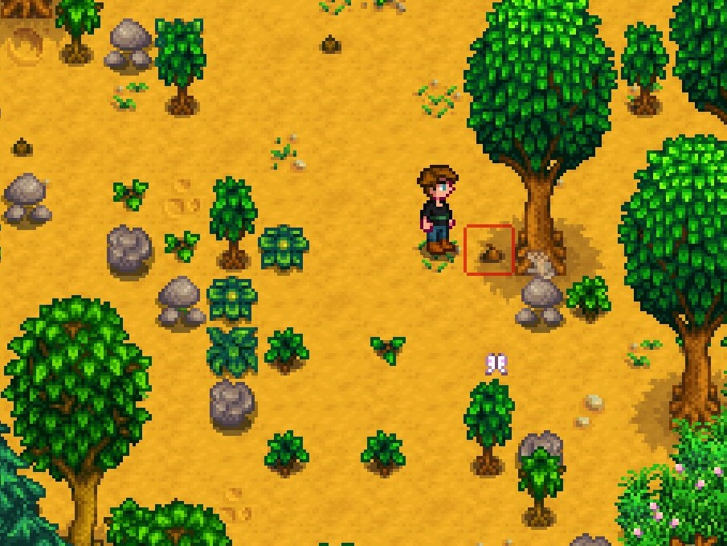
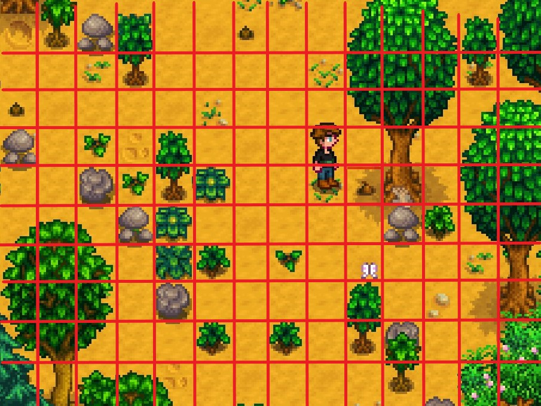
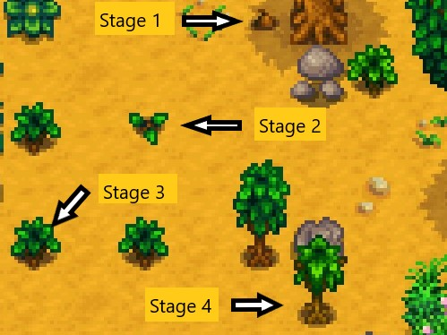
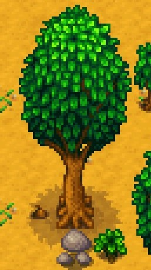

# Trees in Stardew Valley

## The farm is a grid

The first thing to notice is that everything on the farm happens on a grid. The
red square below marks a single cell. 

Drawing the full grid makes it clear that each tree, tuft of grass, bush and so
on occupies exactly one cell.

## Growth stages

Focusing on the trees, there are five stages of a living tree. The first four
are:

1. a planted **seed**,
2. a germinated **seedling**,
3. a **bush**,
4. a **sapling**.

The fifth stage is a **mature tree**.

Trees can also be cut down, leaving a stump which occupies a cell. This stump 
can be removed by the player. However, we really want to model the behavior without 
the player. The stump can be thought of as a sixth stage. 

## Different species

There's several different species of tree in the game such as maple, oak, 
and pine. For the most part, each species has the same growth behavior, but
how different species might compete or coexist with one another is something 
we might consider with the model. We need to keep that in mind.

## Tree Growth

In the game, the forest actually only grows and spreads at night after the player
sleeps (transitioning between days). Unless the player modifies something,
the state of the forest is constant for each day and undergoes a discrete 
transition each night. 

The oak, maple, and pine trees have a chance to grow per night. The game
rolls for growth and if the roll succeeds, the growth stage increments by one. 
According to the [Stardew Valley wiki on trees](https://stardewvalleywiki.com/Trees#Growth_Cycle),
the chance is 20% each night, except for the transition from sapling (4th stage) 
to mature tree (5th stage) which takes "twice as a long", or a 10% chance each night.
However, the transition to mature tree does not occur for a given cell with a stage 4
sapling, if there is another mature tree of any species in any of 8 surrounding cells 
(AKA the Moore neighborhood). For instance, the blue cell below can go from stage 4
to stage 5 only if none of the gray cells contain a stage 5, already.

Note that these transition probabilities only apply to unfertilized trees in *Stardew Valley*.
And there are a number of another exceptions. 

Growth can happen any night, except nights in winter. The game models four seasons of 
28 days each.

There are several possible variations on these rules. One is that the size of the neighborhood which 
cause competition and prevents a growth transition could vary, and it could vary
with growth stage so that later stages interfere with each other more. Alternatively, 
the transition probability could increase or decrease rather than dropping to zero. The
seasons could always influence the transition probability. 

For more realistic models, the transition probability would be tied to things like
photosynthesis and water availability, etc. But let's not worry about that now.

## Tree Reproduction 

To simulate tree spread, for each mature tree, the game rolls to see if a tree
spawns a seed with a 15% probability, then if successful, the game randomly selects
a cell in the 7 by 7 box centered on the mature tree (box of radius 3). 
The select is empty, then a new sapling of the same species is spawned in 
the selected cell. Note mathematically, this reproduction is asexual even though
real seeds are the fruit of sexual reproduction (pun intended).

So the actual probability of success depends on the availability of empty cells,
and it is not a guaranteed 15% chance. Moreover, this rule does not permit more 
than one new seed per mature tree per night. We can consider other rules like
a distribution for the number of offspring. Similarly, we could consider
variations in the size of box into which new seeds can spawn. 

## From the game's rules to a mathematical model
In summary, both space and the tree's life cycle are discrete states with stochastic
updates. We can analyze the dynamics all several lines. First, the system is 
a kind of stochastic **cellular automaton**, the subject of the
[next chapter](math/cellular-automata.md). Stochastic cellular automata are a kind
of [Markov chain](math/markov-chain.md). However, we can also used the 
math of structure populations to model the population dynamics as well. 
